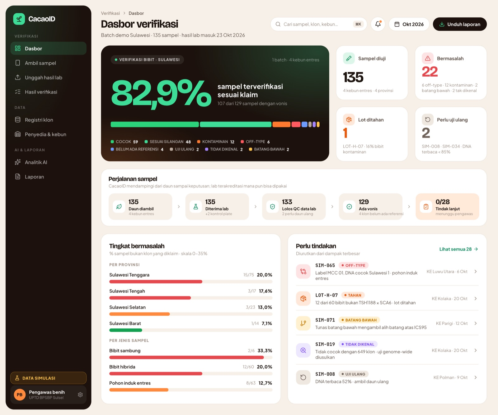
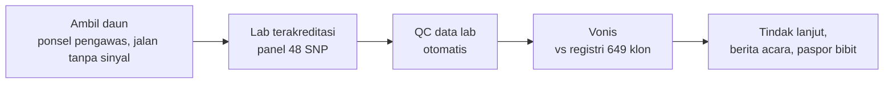
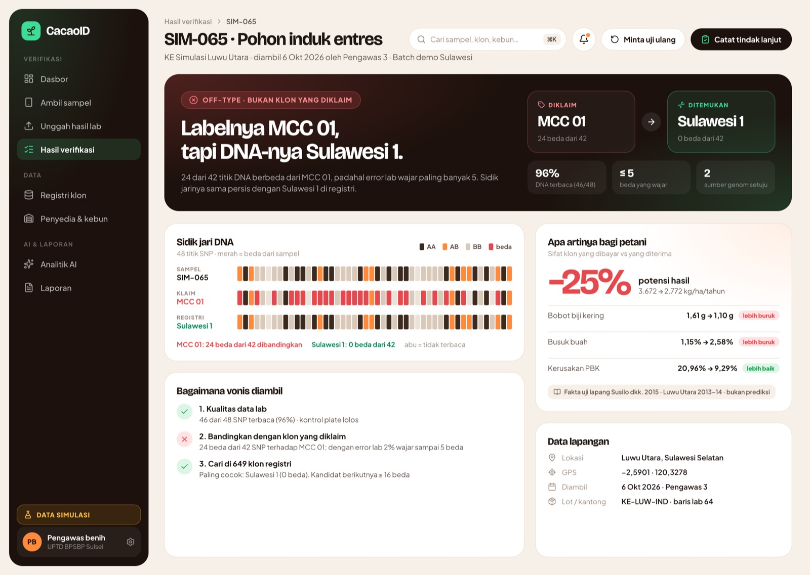
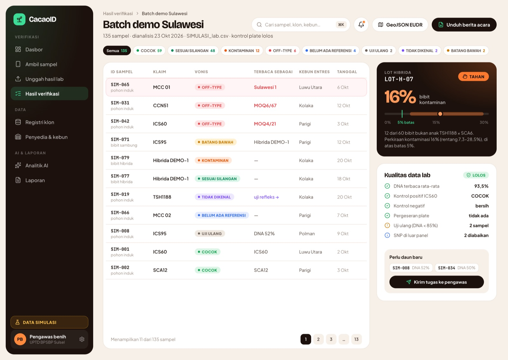
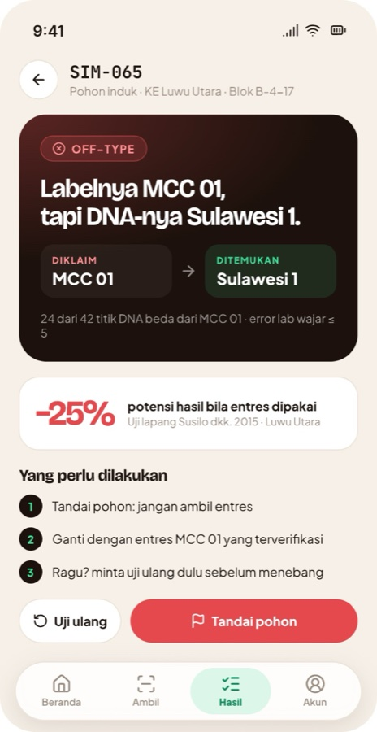

# CacaoID

**Verifikasi genetik bibit kakao.** CacaoID memastikan bibit dan pohon induk yang dibayar petani
benar-benar klon yang dijanjikan, dari sehelai daun sampai berita acara.

> Prototipe untuk GenoHack 2026 (ITB, Track 2 *Food Security & Biodiversity Genomics*).
> Semua data demo adalah **DATA SIMULASI**. Data publik yang dipakai tercantum di
> [`apps/api/data/ATTRIBUTION.md`](apps/api/data/ATTRIBUTION.md).



## Masalah

- **Klon bibit kakao saat ini diperiksa secara visual.** Pedoman benih kakao tidak menyebut uji DNA, dan saat sertifikasi hanya sebagian kecil bibit per lot yang dilihat.
- **Bibit yang salah klon baru ketahuan bertahun-tahun kemudian,** ketika pohon sudah berbuah.
- **Dampaknya nyata.** Di uji lapang Luwu Utara, potensi hasil Sulawesi 1 **25% lebih rendah** daripada MCC 01 (Susilo dkk. 2015). Pohon induk berlabel MCC 01 yang ternyata Sulawesi 1 menurunkan kerugian itu ke setiap bibit sambung dari entresnya.

## Solusi: pendamping verifikasi

CacaoID tidak membangun lab. Genotyping SNP sudah menjadi layanan umum, dan **lab terakreditasi mana
pun bisa dipakai**. CacaoID mendampingi pengawas benih di sepanjang alur:



Wewenang sertifikasi tetap di pengawas benih (UPTD BPSBP). CacaoID menyediakan alur, registri sidik
jari, vonis yang bisa dipertanggungjawabkan, dan laporannya.

### Vonis

| Vonis | Artinya |
|---|---|
| **COCOK** | DNA sama dengan klon yang diklaim (beda masih dalam batas error lab) |
| **OFF-TYPE** | Bukan klon yang diklaim; bila ada, disebutkan klon yang cocok |
| **BATANG BAWAH** | Tunas batang bawah mengambil alih batang atas |
| **TIDAK DIKENAL** | Tidak cocok dengan klon mana pun di registri, lalu diusulkan uji lanjutan |
| **BELUM ADA REFERENSI** | Klon yang diklaim belum punya sidik jari di registri |
| **UJI ULANG** | Data lab tidak cukup (DNA terbaca < 85%) |

Lot bibit hibrida diperiksa per bibit (**SESUAI SILANGAN** / **KONTAMINAN**), lalu lotnya
diputuskan **LOLOS**, **TAHAN**, atau **TAMBAH SAMPEL**.

## Fitur

**Verifikasi**
- Ambil sampel di ponsel. Sampel tersimpan di perangkat saat tidak ada sinyal dan terkirim otomatis saat online.
- QC data lab otomatis:
  - sampel tergeser di plate;
  - untai DNA terbalik;
  - kontrol positif dan negatif;
  - ID yang ditulis ulang lab;
  - SNP yang hilang.
- Vonis identitas dengan toleransi error lab (statistik likelihood, bukan tebakan).
- Batang bawah dan asal biji (uji Mendel terhadap hipotesis tertentu).
- Kontaminasi serbuk sari di lot hibrida, dengan rentang keyakinan dan kalkulator jumlah sampel.

**Dampak, registri, dan penyedia**
- "Apa artinya bagi petani": sifat klon yang dibayar dibandingkan dengan yang diterima. Sumbernya fakta uji lapang, bukan prediksi.
- Registri 649 sidik jari referensi dari genom publik dan bank gen. Sinonim dan konflik antar-sumber ditandai.
- Skor risiko penyedia menentukan berapa daun yang diambil per kebun. Skor ini memakai aturan terbuka + penghalusan Bayes, bukan AI.

**Laporan**
- Berita acara siap cetak.
- Jejak audit berantai hash.
- Paspor bibit dengan skrining deforestasi EUDR, plus ekspor GeoJSON.

**Analitik AI untuk pemulia**

| Model | Tervalidasi untuk | Tidak untuk |
|---|---|---|
| Ketahanan busuk buah | Ranking semaian dalam satu silangan (simpan 25% teratas → busuk buah −14%, r 0,40) | Membandingkan klon |
| Komponen hasil | Biji per buah, ukuran biji, pod index (r 0,51–0,66 antar-klon) | Hasil panen per hektare |
| Asal-usul genetik | Perkiraan latar genetik pohon tak dikenal (78% benar) | Kepastian; 6–8% yakin tapi salah |

Rincian validasi ada di [`apps/api/tasks/VALIDASI_MODEL.md`](apps/api/tasks/VALIDASI_MODEL.md).

## Bukti

- **Simulasi:** panel 38 SNP mencapai recall 100% dan presisi 99,8%.
- **Data nyata Kolombia** (Osorio-Guarín dkk. 2025): 170 dari 171 plot salah label versi paper ditemukan ulang.
- **Data nyata 495 pohon F1** (Jacquotte dkk. 2026): silangan yang benar ditemukan 90,6%.
- **Kekurangan yang ditemukan beserta tambalannya** tercatat di [`apps/api/tasks/GAPS.md`](apps/api/tasks/GAPS.md). Setiap tambalan disertai test regresi.

## Tangkapan layar

| Detail sampel SIM-065 | Hasil verifikasi batch |
|---|---|
|  |  |



Mockup lengkap (12 layar): [`docs/design/CacaoID-mockup-v2.pdf`](docs/design/CacaoID-mockup-v2.pdf).

## Status

| Bagian | Kondisi |
|---|---|
| `apps/api` | Berjalan: engine vonis, QC lab, parentage, kontaminasi lot, AI, audit, pencarian, 80 test |
| `apps/web` | Semua halaman web dan ponsel tersambung ke API; Analitik AI masih statis (Major). Semua butir Minor di [`ROADMAP.md`](ROADMAP.md) selesai |

## Teknologi

| Bagian | Stack |
|---|---|
| Web | React 19, Vite 6, TypeScript, Tailwind CSS 4, react-router 7, lucide-react, react-top-loading-bar |
| API | Python 3.12, FastAPI, SQLModel (SQLite), NumPy, scikit-learn, rasterio |
| Monorepo | pnpm workspaces; Python dikelola uv |

## Menjalankan

Prasyarat: Node.js 20+ dan pnpm 9, Python 3.12, serta [uv](https://docs.astral.sh/uv/).

```bash
pnpm install   # dependensi web
pnpm seed      # sekali: buat data simulasi + batch demo (dependensi Python dipasang otomatis oleh uv)
pnpm dev       # web http://localhost:5174, api http://localhost:8001 (dokumentasi API: /docs)
pnpm test      # test api (±2 menit)
pnpm build     # typecheck + build web
```

Reset data demo: hentikan `pnpm dev`, hapus `apps/api/cacaoid.db`, lalu `pnpm seed`.

## Struktur

```
apps/api        FastAPI + engine Python (vonis, QC, AI). Lihat apps/api/README.md
apps/web        React 19 + Vite + Tailwind 4 (mockup v2). Lihat apps/web/README.md
docs/           pengetahuan produk, keputusan, dan desain
ROADMAP.md      urutan pengembangan fitur, Major/Minor per fase
```

## Baca dulu sebelum mengerjakan fitur

| Dokumen | Isi |
|---|---|
| [`docs/KEPUTUSAN.md`](docs/KEPUTUSAN.md) | Keputusan produk, bisnis, dan teknis: posisi pendamping, satu peran, peran AI, isu terbuka, angka demo |
| [`ROADMAP.md`](ROADMAP.md) | Apa yang dikerjakan berikutnya dan endpoint yang dipakai |
| [`apps/web/CLAUDE.md`](apps/web/CLAUDE.md) | Aturan UI: token desain, warna vonis, aturan isi agar tahan ditanya juri |
| [`CLAUDE.md`](CLAUDE.md) | Aturan monorepo dan API (dipakai juga oleh Claude Code) |
| [`apps/api/tasks/GAPS.md`](apps/api/tasks/GAPS.md) | Kekurangan sistem yang sudah ditemukan, cara reproduksi, dan tambalannya |
| [`apps/api/tasks/VALIDASI_MODEL.md`](apps/api/tasks/VALIDASI_MODEL.md) | Seberapa jauh tiap model AI boleh diklaim |
| [`docs/produk/Riset-Perbaikan-Pitch-CacaoID.md`](docs/produk/Riset-Perbaikan-Pitch-CacaoID.md) | Harga per sampel, roadmap 12 bulan, cerita demo, regulasi benih kakao, praktik di luar negeri |
| [`docs/produk/Overview-Produk-CacaoID.md`](docs/produk/Overview-Produk-CacaoID.md) | Gambaran produk lengkap (beberapa bagian usang, lihat peringatan di atasnya) |
| [`docs/produk/Slide-Fitur-CacaoID.md`](docs/produk/Slide-Fitur-CacaoID.md) | Penjelasan tiap fitur sesuai deck |
| [`docs/produk/Riset-Dataset-Terbuka-Kakao.md`](docs/produk/Riset-Dataset-Terbuka-Kakao.md) | Dataset publik yang bisa dipakai |
| [`docs/produk/riset-validasi-bisnis/`](docs/produk/riset-validasi-bisnis/) | Riset volume, kasus, dan harga |
| [`docs/produk/Kit-Wawancara-CacaoID.md`](docs/produk/Kit-Wawancara-CacaoID.md) | Panduan wawancara validasi pengguna (memuat kontak; jangan dipublikasikan) |

## Aturan kerja tim

- Ambil butir dari `ROADMAP.md`. Yang tersisa adalah butir Major: tulis desain singkat dan test dulu.
- Angka di UI berasal dari API (`apps/web/src/data/demo.ts` hanya untuk Analitik AI). Jangan mengetik angka sendiri.
- Ambang keputusan hanya diubah di `apps/api/src/cacaoid/config.py`, dan setiap perubahan disertai test.
- Kekurangan baru dicatat di `apps/api/tasks/GAPS.md`. Keputusan baru dicatat di `docs/KEPUTUSAN.md`.
- `pnpm test` harus lolos sebelum menggabungkan perubahan API.

## Data dan lisensi

Data publik dipakai hanya untuk membangun dan menguji prototipe, dan lisensinya berbeda-beda per
sumber (kebanyakan CC BY 4.0 atau CC0). Cek
[`apps/api/data/ATTRIBUTION.md`](apps/api/data/ATTRIBUTION.md) sebelum ada penggunaan komersial.
Genotipe klon Indonesia yang belum publik (mis. MCC 02, ICCRI 03/04/06H/08H) harus didapat dari
pemilik klonnya.
